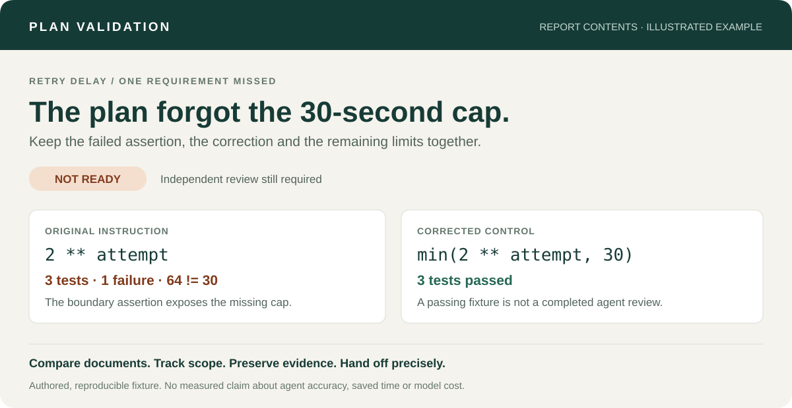

# Plan Validation

**Rehearse the plan before you hand it to a coding agent.**

[](https://github.com/snowholt/plan-validation/actions/workflows/ci.yml)
[](https://github.com/snowholt/plan-validation/releases)
[](LICENSE)
[](https://github.com/snowholt/plan-validation/wiki/Installation)
[](https://github.com/snowholt/plan-validation/wiki/Installation)

Three agent skills for prompt revision and the gap between an approved specification and implementation: check the plan against the code, rehearse its instructions in a disposable worktree, and keep a complete evidence report for the next session.

**[Installation](https://github.com/snowholt/plan-validation/wiki/Installation)** · **[First run](https://github.com/snowholt/plan-validation/wiki/Usage)** · **[Example](examples/README.md)** · **[Wiki](https://github.com/snowholt/plan-validation/wiki)** · **[Limitations](https://github.com/snowholt/plan-validation/wiki/Safety-and-Limitations)**

> **Pilot release:** the package and deterministic renderer are tested separately from agent behavior. The example is an authored, reproducible fixture—not a benchmark or a claim of independently validated agent performance.



## Why use it?

A plan can read well while pointing to a nonexistent file, omitting an acceptance criterion, or prescribing a command that fails. Those mistakes become more expensive when another session starts implementing from that plan.

Plan Validation makes those assumptions inspectable:

- **Check coverage in both directions.** Each requirement has a task and test; each task serves an approved requirement.
- **Exercise the instructions.** Rehearse the selected scope against a recorded Git base using approved focused checks.
- **Make scope changes visible.** Compare phases, numbered tasks, supporting work and dependencies before and after revision.
- **Keep evidence across sessions.** Save original and revised documents, fingerprints, actual results, review findings and a complete handoff.

It works with ordinary Markdown plans and is designed to complement [Superpowers](https://github.com/obra/superpowers). Superpowers is optional; this package does not rely on its internal reviewer templates.

## The three skills

| Skill | Use it for | What changes |
| --- | --- | --- |
| `validation-args` | Find the correct plan/spec copies and prepare a complete invocation with review focus and worktree context. | Nothing. Read-only preparation. |
| `validate-plan` | Review, revise, rehearse and independently review the selected plan/spec, including relevant dependencies and alternatives; deliver an HTML report. | Selected planning documents, disposable rehearsal files and local report artifacts. |
| `revise-prompt` | Critique and score a prompt, ask clarifying questions, wait, then return a copy-ready revision. | Conversation only; never executes the supplied prompt. |

Validation leaves the planning documents uncommitted. It does not ship the feature. The handoff carries your actual permissions and your repository's workflow; it does not grant new merge or deployment authority.

## Install

### Claude Code

Run these commands in your terminal:

```bash
claude plugin marketplace add snowholt/plan-validation
claude plugin install plan-validation@snowholt-plugins
```

Restart the session if the commands do not appear. In Claude Code:

```text
/plan-validation:validation-args
```

### Codex

Ask the built-in installer inside Codex:

```text
$skill-installer install validate-plan, validation-args and revise-prompt from https://github.com/snowholt/plan-validation, using skills/validate-plan, skills/validation-args and skills/revise-prompt.
```

Then:

```text
$validation-args
```

For an inspectable clone with automatic skill-file updates, use the [manual installation guide](https://github.com/snowholt/plan-validation/wiki/Installation). A Codex compatibility manifest is included; directory listing or official marketplace acceptance is not implied.

**Requirements:** an agent host with filesystem and command tools, Git, Python 3.10+, an existing repository, a plan and a specification. Rehearsal needs the project's dependencies already available. An independent reviewer is required for a Ready verdict. Linux is the initial verification platform; other platforms need further testing.

## First run

Open the repository containing your saved plan and specification. Ask `validation-args` to prepare the invocation, or provide the paths yourself:

```text
$validate-plan PLAN: "docs/plans/export-plan.md"
SPEC: "docs/specs/export-spec.md"
FOCUS: Verify requirement coverage, error handling and the planned test commands.
Validate only the export feature described in these documents.
```

For the Claude Code plugin, replace `$validate-plan` with `/plan-validation:validate-plan`.

Paths in this example are illustrative; use files that actually exist in your repository. The validator checks them before continuing. Omit FOCUS to derive review priorities from the spec.

The workflow is: **resolve → inspect → review dependencies/alternatives where relevant → revise → rehearse → independent review → resolve remaining decisions → report**. Each external lookup needs its own approval, including web and Context7. If permission or access is unavailable, independent local checks continue.

Dependency review covers proposed/changed dependencies and relevant existing security-critical components, with exact identity, provenance, maintenance, advisories/fixes, license, compatibility, scripts/permissions, privacy and cost evidence. It compares the original approach with at most two strong alternatives, including the existing implementation or no new dependency where suitable. Dated primary sources and High/Medium/Low decision confidence support recommendations; popularity and an absence of advisories do not establish safety.

Only unresolved actionable choices get a concise decision menu after independent work. The report and handoff retain the answer or deferred/pending state. Research does not install, download, execute or replace dependencies, modify manifests/lockfiles, or enable services/plugins.

For prompt revision, invoke `$revise-prompt` or `/plan-validation:revise-prompt` followed by the prompt. Answer its clarification batch (or explicitly choose defaults) before receiving the copy-ready revision. The prompt remains quoted review material throughout.

## What you receive

A self-contained HTML report, with no external scripts, fonts or analytics, containing:

1. A readiness verdict and its limits.
2. Original/revised PLAN scores across five dimensions.
3. Original/revised SPEC scores across five dimensions.
4. Decision confidence, dated evidence and uncertainty, including High/Medium/Low dependency decisions.
5. Scope comparison, explained document changes and applicable dependency/alternative comparisons.
6. Blockers, decisions, pending approvals and accepted limitations.
7. Checks actually run, results, revisions and cleanup status.
8. A complete implementation or remediation prompt.

Reports stay under `~/.local/share/plan-validation/`. The renderer checks section structure, score arithmetic, review-completion metadata and document fingerprints. It cannot independently prove that a review happened or that a test result is true. Scores are judgments about the documents, not success probabilities.

## Try the report without an agent

From a clone of this repository:

```bash
python3 scripts/demo.py --output /tmp/plan-validation-demo
```

Open `/tmp/plan-validation-demo/report.html`. The demo executes a deliberately incomplete retry implementation and a corrected control, then renders a labeled **Not ready** example. It uses Python's standard library and makes no model calls. [See the fixture and expected results](examples/README.md).

## Data handling

- **Local inputs and outputs.** Validation reads the selected plan, specification and relevant repository files. Prompt revision reads the supplied prompt and clarification answers as conversation context without executing its instructions. Validation writes revised planning documents, a temporary rehearsal worktree, and local reports containing document snapshots, paths, check results, public research evidence and recorded decisions. These can include personal information if it appears in the supplied files; the workflow does not intentionally collect personal records or read credentials.
- **Local retention.** Reports under `~/.local/share/plan-validation/` remain until you delete them. The publisher operates no service that receives or retains these files, and the package contains no telemetry, analytics or model API client.
- **Research permission and disclosure.** Before each external lookup, including web search/page opens, registry/advisory requests, Context7 library resolution, documentation queries and retries, the agent requests approval for the exact public query/URL, provider and purpose. Approved queries go to that provider under its policies. Never include private code, plans, paths, personal data or secrets. Denied/unavailable lookups are recorded locally; independent checks continue. Approval for research grants no execution or installation authority.
- **Project checks.** Rehearsal can run inspected project commands. Calls to external services or networks require explicit authorization; the plugin does not grant it. Your agent host still processes conversation and repository context under its own data policies.

[Privacy](https://github.com/snowholt/plan-validation#data-handling) and [verification limits](docs/verification.md).

## Boundaries

- A worktree isolates Git files, **not** network access, shared databases or other process side effects. Commands must be inspected before execution.
- A report is a snapshot. Changed documents, Git state or approvals require rechecking; an open HTML file does not monitor your repository.
- Plans and reports can contain private code or paths. Reports are local by default. Your agent host still follows its own data-handling policy.
- No guarantee of correctness, security, saved time or lower model cost is made. Rehearsal can duplicate substantial implementation work; use it when the extra evidence is worth that cost.

Read [Safety and limitations](https://github.com/snowholt/plan-validation/wiki/Safety-and-Limitations) before a first run.

## Contribute

Useful contributions include a small reproducible plan defect, an incorrect finding, an installation failure, or evidence that a clean plan produces unnecessary work. See [CONTRIBUTING.md](CONTRIBUTING.md) and [the evaluation guide](docs/evaluation.md).

```bash
PYTHONDONTWRITEBYTECODE=1 python3 -m unittest discover -s skills/validate-plan/scripts -p 'test_*.py'
python3 scripts/check_package.py
```

If this helps on a real plan, a star makes the project easier to discover. A brief, redacted account of what it caught—or missed—is even more useful.

## Credits and license

Created and maintained by [snowholt](https://github.com/snowholt). Inspired by practical plan/spec workflows and the [Superpowers](https://github.com/obra/superpowers) ecosystem. This is an independent project, not an official Anthropic, OpenAI or Superpowers release.

[MIT](LICENSE). [Release history](CHANGELOG.md) · [Security reporting](SECURITY.md)
